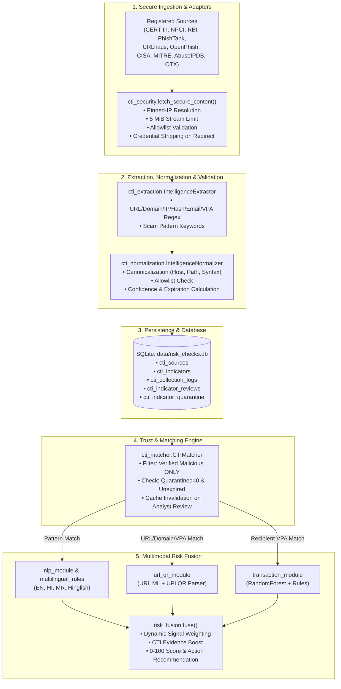

# Cyber Threat Intelligence (CTI) Architecture — UPI Fraud Guard

This document describes the implemented end-to-end CTI architecture in `upi-fraud-guard-v3`.

## Key Architectural Principles

1. **No Fake / Static Fallback IOCs**: Connectors never substitute hardcoded sample IOCs when network calls fail or credentials are missing. A failed fetch logs an error and updates source status without inserting fabricated records.
2. **Pinned-IP and Stream-Bounded Fetching**: All outbound HTTP traffic validates destination hostnames against an allowlist, resolves addresses once to check for private/loopback/cloud-metadata IPs, and pins the socket directly to that IP. Response bodies are streamed with a hard limit of 5 MiB.
3. **Explicit Verification Gate**: IOC matching in pre-transaction risk scoring strictly requires `Verified Malicious` status, active lifespan (`expires_at > now`), and non-quarantined status. Confidence score alone is insufficient to trigger high-risk alerts.
4. **Cache Invalidation**: Any manual analyst status review through `/api/intelligence/indicators/{id}/review` invalidates the matcher's indicator cache immediately.
5. **Preserved Multilingual Detection**: CTI message pattern checks complement the existing English, Hindi, and Marathi NLP models and regex rules without replacing them.
